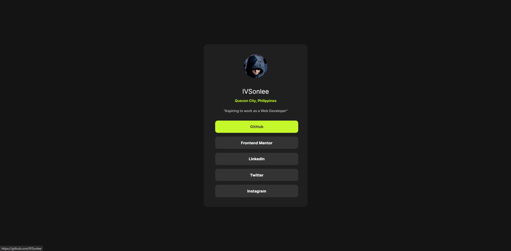

# Frontend Mentor - Social links profile solution

This is a solution to the [Social links profile challenge on Frontend Mentor](https://www.frontendmentor.io/challenges/social-links-profile-UG32l9m6dQ). Frontend Mentor challenges help you improve your coding skills by building realistic projects. 

## Table of contents

- [Overview](#overview)
  - [The challenge](#the-challenge)
  - [Screenshot](#screenshot)
  - [Links](#links)
- [My process](#my-process)
  - [Built with](#built-with)
  - [What I learned](#what-i-learned)
  - [Continued development](#continued-development)
  - [Useful resources](#useful-resources)
  - [AI Collaboration](#ai-collaboration)
- [Author](#author)
- [Acknowledgments](#acknowledgments)

## Overview

### The challenge

Users should be able to:

- See hover and focus states for all interactive elements on the page

### Screenshot



### Links

- Solution URL: [Github Repository](https://github.com/IVSonlee/Social-links-profile)
- Live Site URL: [Live Site URL](https://ivsonlee.github.io/Social-links-profile/)

## My process

### Built with

- Semantic HTML5 markup
- CSS custom properties
- Flexbox
- CSS Transition
- CSS Navigation
- CSS Alignment

### What I learned

```CSS
.container_profile > div:first-child
{
    height: 28vh;
    text-align: center;
}
.container_profile > div:last-child
{
    align-items: center;
    display: flex;
    height: 36vh;
    justify-content: center;
}

/*Inside a parent element I use :first-child and :last-child I use these because it has two elements that are similar which is <div> the purpose of these is to apply a specific design changes whether
the first or last element inside a parent element*/

img[alt] /*I used a attribute selector in order to design a selector with an attribute of alt*/
{
    border-radius: 3em;
    height: 5.5em;
}

h2
{
    color: hsl(0, 0%, 100%);
    font-family: Inter_Regular;
    position: relative;
    top: -20px;
}
h5
{
    color: hsl(75, 94%, 57%);
    font-family: Inter_SemiBold;
    position: relative;
    top: -30px;
}
p
{
    color: hsl(0, 1%, 65%);
    font: normal 400 13px Inter_SemiBold;
    position: relative;
    top: -30px;
}

/*I used position: relative in order to adjust the top,right,bottom,left position of an element*/

.container_profile > div:last-child li
{
    align-items: center;
    background: hsl(0, 0%, 20%);
    border-radius: 10px;
    color: white;
    display: flex;
    font: normal 0.9em Inter_Bold;
    height: 3.2em;
    justify-content: center;
    margin-left: -2.2em;
    margin-bottom: 1em;
    transition: background-color 0.5s ease-out;
}

.container_profile > div:last-child li:hover
{
    background-color: hsl(75, 94%, 57%);
    
}
.container_profile > div:last-child a
{
    color: inherit;
    text-decoration: none;
    transition: color 0.5s ease-out;
}
.container_profile > div:last-child a:hover
{
    color: hsl(0, 0%, 20%);
}
/*Using transition that can be applied when I hover makes a difference when it comes to the timing of the changes being applied to a specific attribute*/
```
### Continued development

- I will use this to show my skills and understanding in my personal portfolio website
- There are some links that are not yet being applied like Twitter and Instagram


### Useful resources

- [Sonlee Programming Repository](https://github.com/IVSonlee/Sonlee-Programming) - This repository serves as my reviewer of every coding languages it will be my guide when I forgot the purpose of a specific command

### AI Collaboration

None

## Author

- Frontend Mentor - [@IVSonlee](https://www.frontendmentor.io/profile/IVSonlee)
- Jobstreet - (ph.jobstreet.com/profiles/iversonrichmond-lee-QkPdmlXNHv)
- LinkedIn - (www.linkedin.com/in/iverson-richmond-lee-332029405)

## Acknowledgments

[Author] - IVSonlee

- Jobstreet Profile: https://ph.jobstreet.com/profiles/iversonrichmond-lee-QkPdmlXNHv
- LinkedIn Profile: www.linkedin.com/in/iverson-richmond-lee-332029405
- Github Profile: https://github.com/IVSonlee

